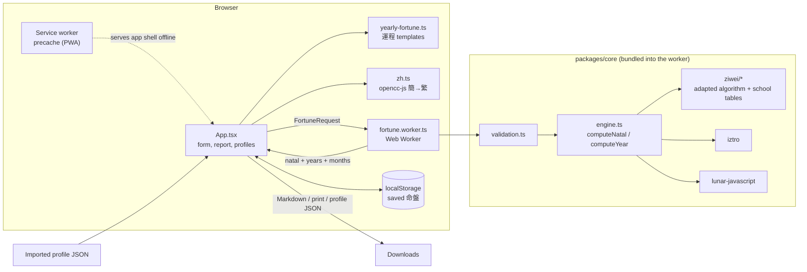
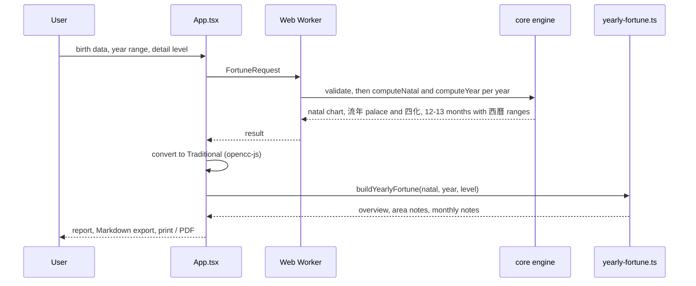
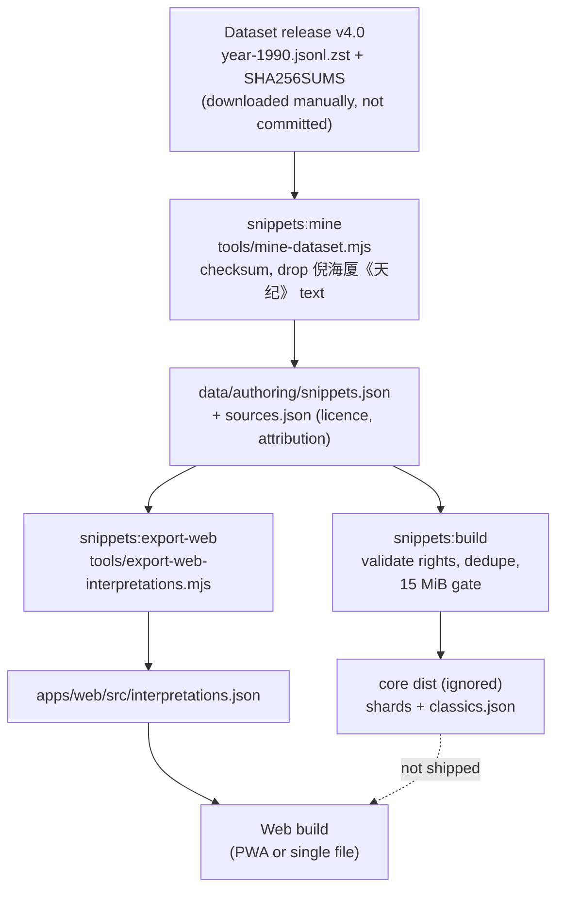

# Annual Fortune

An offline-first workspace for calculating Zi Wei Dou Shu chart structure and preparing annual report requests. The web app stores saved profiles in browser storage and includes a PWA build and a single-file HTML build.

## Development

```sh
npm install
npm run dev
```

Requires Node.js 20 or newer. `npm run dev` builds `packages/core` first because the web app imports its `dist`; after changing core code, rebuild it with `npm run build`.

## Architecture

This is an npm-workspaces monorepo with no backend. Everything runs in the browser.

| Path | Role |
| --- | --- |
| `packages/core` | Calculation engine (`src/engine.ts`, `src/ziwei`), request validation, worker contract, and the build-time snippet tools in `tools/`. |
| `apps/web` | React + Vite UI, the Web Worker (`src/fortune.worker.ts`), the local 運程 reading generator (`src/yearly-fortune.ts`), and PWA / single-file builds. |

### Components



### Request flow



No birth data leaves the device. The only data written is saved profiles in `localStorage`.

## Where data and models come from

| What | Source | Where it is stored | When it is used |
| --- | --- | --- | --- |
| Chart algorithm and school tables | Adapted from [Renhuai123/ziwei-doushu](https://github.com/Renhuai123/ziwei-doushu) (MIT, pinned commit; see below) | `packages/core/src/ziwei` (committed) | Runtime, in the worker |
| Star placement and 四化 | `iztro` (MIT) | npm dependency of core | Runtime, in the worker |
| Lunar calendar, leap months, 西曆 ranges | `lunar-javascript` (MIT) | npm dependency of core | Runtime, in the worker |
| 運程 reading text | Authored templates and star-trait tables, written for this project | `apps/web/src/yearly-fortune.ts` (committed) | Runtime, in the UI thread |
| Natal 宮位星曜 reference text | Mined from the CC BY 4.0 [interpretation dataset v4.0](https://github.com/Renhuai123/ziwei-doushu/releases/tag/v4.0-13d) | Registry `packages/core/data/authoring/sources.json`, mined entries `snippets.json`, exported to `apps/web/src/interpretations.json` (all committed) | Runtime, shown in a collapsed section with attribution |
| Simplified→Traditional conversion | `opencc-js` | npm dependency of web | Runtime, display only |
| Third-party licence notices | Collected by hand | `apps/web/src/third-party-licenses.txt` | Shown in the app |
| Saved 命盤 | The user | Browser `localStorage`; exported or imported as JSON | Runtime |

The raw dataset (`*.jsonl.zst`, hundreds of MB) is never committed or bundled. It is downloaded manually, mined once, and only the reviewed result is kept.



Run the snippet scripts from the repo root with `npm run snippets:build` and `npm run snippets:coverage`; `snippets:mine` and `snippets:export-web` are core workspace scripts (`npm run snippets:mine --workspace @annual-fortune/core -- <file.jsonl.zst> [SHA256SUMS.txt]`). The authoring rules are in [`packages/core/data/authoring/README.md`](./packages/core/data/authoring/README.md).

## Checks and builds

```sh
npm test
npm run build
npm run build:single
```

The normal build writes the installable web app to `apps/web/dist`. The single-file build writes a self-contained `apps/web/dist/index.html`.

## Calculation boundary

The app calculates the natal chart and yearly palace, transformations, and annual stars locally in a Web Worker. Late Zi births (23:00–23:59) use the following calendar day. Birth-time input is used as entered: city coordinates, historical daylight-saving adjustments, and true-solar-time correction are not yet available. A male or female selection is required because the engine uses it to determine decade-cycle direction.

The UI is Traditional Chinese only (engine output is converted from Simplified with `opencc-js` at display time). Each year shows a plain-language 運程 reading built locally in `apps/web/src/yearly-fortune.ts`: the 流年命宮 position, where each 流年四化 lands among the 12 palaces, and per-area (事業, 財運, 感情, 健康 …) notes derived from natal star traits. The text is authored templates, not licensed data, and is for cultural reference. Detail levels: 精簡 shows the overview and 四化 notes, 標準 adds per-area notes, and 深入 adds 逐月運程 (every lunar month, including leap months, with its 西曆 date range). Each month's tone (機會較多／平穩／宜謹慎) is scored from where its 四化 land, weighting 命, 財帛, 官祿, 疾厄 and 田宅 more heavily. A collapsed section lists the natal palace/star interpretations mined from the CC BY 4.0 dataset (partial coverage). "匯出完整報告" downloads Markdown for the whole year range, and "列印／存成 PDF" uses the browser print dialog. Saved 命盤 can be renamed, exported as `.json` and imported back. City lookup and true-solar-time correction are not included. The app does not send birth information to a server.

## Snippet authoring pipeline

The build-time-only authoring pipeline is in `packages/core/tools` and reads its source registry and authored entries from `packages/core/data/authoring`; the input schema and review requirements are documented in [`packages/core/data/authoring/README.md`](./packages/core/data/authoring/README.md). It validates rights evidence and attribution, deduplicates entries into dimension shards and `classics.json`, pins the `quanshu` school setting, and measures the compressed payload against the 15 MiB gate. Generated files stay under the ignored core `dist` directory and are not included in either web build.

Run `npm run snippets:build` to validate and build the shards, and `npm run snippets:coverage` to check lookups against the star matrix and representative charts. Interpretation snippets are mined at build time from the CC BY 4.0 [Ziwei Doushu interpretation dataset v4.0](https://github.com/Renhuai123/ziwei-doushu/releases/tag/v4.0-13d) (see the authoring README for the rules); quoted 倪海厦《天纪》 text is excluded. Rights and size gates pass, coverage is partial, and missing lookups are reported, never filled with generated interpretations.

## Engine provenance

The chart algorithm and school tables in `packages/core/src/ziwei` are adapted from [Renhuai123/ziwei-doushu](https://github.com/Renhuai123/ziwei-doushu), pinned to commit `1059c347231c636bd86ddb78fd8ed430d5de8d2a` and distributed under the MIT License. The upstream license is included at `packages/core/src/ziwei/LICENSE`. The engine uses the MIT-licensed `iztro` and `lunar-javascript` packages. Their notices are displayed in the app and embedded in both the PWA shell and single-file HTML. Only the mined, attributed natal reference text in `interpretations.json` is bundled; the raw dataset is not.

## Deployment

The app is a static site: there is no server, API or environment variable. Build with `npm run build` from the repo root (it builds core, then the web app) and publish `apps/web/dist`. Use Node.js 20 or newer. Navigation is in-page, so no SPA rewrite rules are needed.

Caching: the service worker (`sw.js`) and `index.html` must always be revalidated, otherwise users will not see updates. Hashed files under `assets/` can be cached for a long time. Both hosts below serve `sw.js` revalidated by default; the optional header rules below make it explicit. The app uses `registerType: "prompt"`, so a new version is applied after the user accepts the update.

### Vercel

1. Push the repo to GitHub and import it in Vercel (**Add New → Project**).
2. Leave **Root Directory** as the repo root so the npm workspaces install correctly.
3. Set **Framework Preset** to *Other* and:
   - Install Command: `npm install`
   - Build Command: `npm run build`
   - Output Directory: `apps/web/dist`
4. Deploy. Or use the CLI from the repo root: `npx vercel --prod` (answer the prompts with the values above).

Optional `vercel.json` in the repo root:

```json
{
  "installCommand": "npm install",
  "buildCommand": "npm run build",
  "outputDirectory": "apps/web/dist",
  "headers": [
    { "source": "/sw.js", "headers": [{ "key": "Cache-Control", "value": "no-cache" }] },
    { "source": "/assets/(.*)", "headers": [{ "key": "Cache-Control", "value": "public, max-age=31536000, immutable" }] }
  ]
}
```

### Cloudflare Pages

1. In the Cloudflare dashboard open **Workers & Pages → Create → Pages → Connect to Git** and select the repo.
2. Build settings:
   - Framework preset: *None*
   - Build command: `npm run build`
   - Build output directory: `apps/web/dist`
   - Root directory: leave empty (repo root)
3. Add the environment variable `NODE_VERSION` = `20` (or `22`) under **Settings → Variables and Secrets**.
4. Save and deploy. Or deploy a local build with the CLI:

```sh
npm run build
npx wrangler pages deploy apps/web/dist --project-name annual-fortune
```

Optional `apps/web/public/_headers` (copied into `dist` at build time):

```
/sw.js
  Cache-Control: no-cache
/assets/*
  Cache-Control: public, max-age=31536000, immutable
```

### Single-file build

`npm run build:single` writes one self-contained `apps/web/dist/index.html` (about 3 MB) with no service worker. It can be opened from disk or put on any static host or file share, but it does not install as a PWA. Run `npm run build` again afterwards if you also need the PWA output, because both write to `apps/web/dist`.

### Before releasing

```sh
npm test
npm run build
npm run build:single
```

Then serve `apps/web/dist` with `npm run preview --workspace @annual-fortune/web`, load it once, switch the network off and reload to confirm the app still opens.
